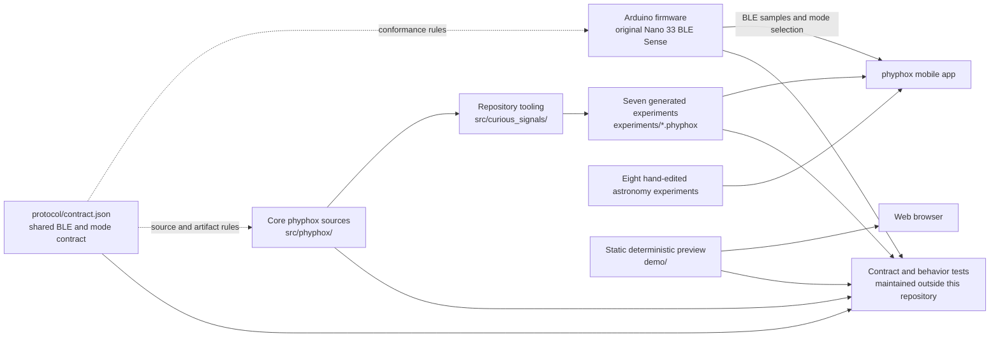
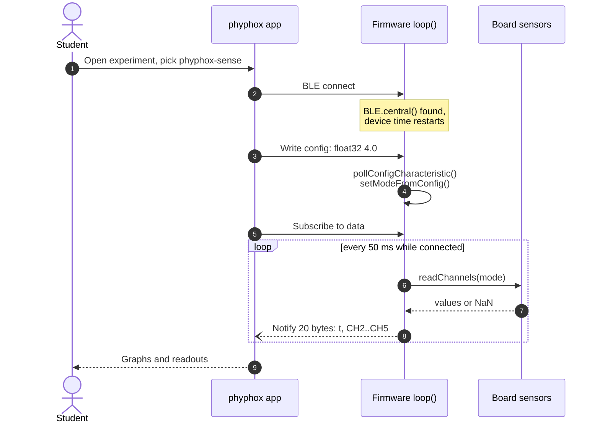
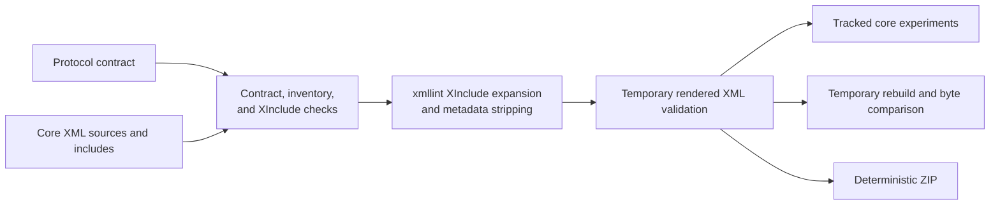
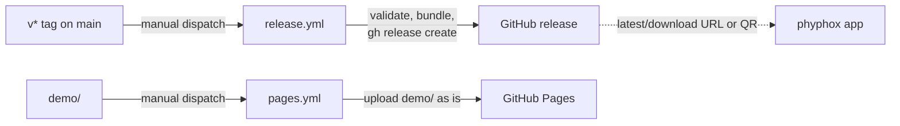

# Architecture

<!-- markdownlint-disable MD013 -->

Curious Signals is a repository of teaching artifacts, not a deployed service or
a single application. It maintains an Arduino and phyphox classroom kit, a
separate astronomy experiment collection, and a static browser preview. The
Python package in `src/curious_signals/` exists only to build and verify those
deliverables; nothing at runtime depends on it.

## System overview



The dashed edges are conformance expectations, not imports. The firmware, the
experiment files, and the preview never load the JSON contract at runtime; each
duplicates the few values it needs, and checks derived from the contract stop
those copies from drifting apart:

- **Firmware:** the sketch stays one self-contained `.ino` that teachers can
  copy into the Arduino IDE; `make validate` checks its UUID, device-name,
  timing, frame-size and mode literals against `protocol/contract.json`.
- **Core experiments:** `make validate` checks sources and generated files
  against the parsed contract (UUIDs, offsets, conversions, mode per filename).
- **Preview:** keep the modes and channel shapes in the preview data module in step
  with the contract.

## Components and ownership

| Path | Responsibility | Runtime or distribution boundary |
| --- | --- | --- |
| `protocol/contract.json` | Device identity, UUIDs, frame encoding, timing, modes, channel meanings, and core filenames | Normative repository contract; not deployed |
| `arduino/phyphox_ble_sense/` | Sensor acquisition, mode selection, BLE service, and notifications | Independently compiled and flashed firmware |
| `src/phyphox/` | Seven editable core experiment definitions and local XInclude fragments | Generator inputs; not distributed directly |
| `experiments/*.phyphox` | Seven generated, importable core experiments | Tracked distributable artifacts |
| `experiments/astronomy/` | Eight directly maintained astronomy experiments | Independent importable artifacts |
| `experiments/drafts/` | Twenty-eight directly maintained additional drafts | Separate draft category; actual acquisition identified per file |
| `docs/drafts/` | Editable companion manuscripts, source review and manifest | Maps drafts to hardware, sources, limitations and fixtures |
| `arxiv/<paper>/` | Independent TeX source, cited bibliography, figures and data for each topic paper, with a local PDF proof | One arXiv submission per folder; matching `YYYY-MM_paper-title` TeX/PDF names; PDF excluded from upload ZIP |
| `demo/` | Deterministic example traces for the core mode shapes | Static browser content; not a BLE client |
| `arduino/toolchain.json` | Pinned board core, sensor libraries, and FQBN | Firmware build reproducibility contract |
| `src/curious_signals/` | Contract parsing, XML generation, validation, parity, bundling, and Arduino provisioning/compilation | Internal contributor tooling |
| `scripts/secret-scan.sh` | Credential-pattern scan behind `make security` | Contributor and CI guardrail |
| `scripts/check_experiment_math.py` | Focused XML analysis interpreter and independent scientific regression fixtures | Software verification behind `make validate`; no runtime dependency |

The astronomy collection may use phone sensors, TI SensorTags, Bluetooth HID, or
supported Owon multimeters. It has no dependency on the Arduino protocol and
never enters the core generator.

Additional drafts may use the existing Nano protocol, external sensor protocols
or explicitly entered observations. `scripts/check_drafts.py` validates their
manifest coverage, structural references and acquisition contracts, then calls
five focused XML fixture groups. The twenty-one topic papers cover all
forty-three experiments. The paper manifest separates the forty-three
`analysis_sources` from the canonical `papers`, whose `analysis_ids` partition
those sources. The original fifteen reductions, twenty-eight additional
reductions and fifteen supplementary analyses retain their own source IDs.
The draft manifest links each device to its canonical paper and retains the
experimental validation status.
`make bundle-drafts` packages the reviewed XML and editable companions locally
under `output/drafts/`; it does not add them to the core release bundle.

How a CSV becomes a page in the retrospective:

```mermaid
flowchart LR
    gen["generate_*example_data.py"]
    csv[("example-data/*.csv")]
    prep["prepare_examples.py<br/>prepare_drafts.py"]
    derived[("docs/papers/data/<br/>*-analysis.json")]
    tex["Paper LaTeX<br/>docs/papers/"]
    arxiv["prepare_arxiv.py"]
    proofs[("arxiv/ folders<br/>and PDF proofs")]
    build["build.py"]
    retro["build_retrospective.py"]
    pdf[("output/pdf/")]

    gen -->|fixed seeds| csv
    csv -->|read, never modified| prep
    prep -->|"plot CSVs, reductions"| derived
    derived -->|pgfplots data, numbers| tex
    tex -->|make arxiv| arxiv
    arxiv -->|compile, zip, recompile| proofs
    proofs -->|make papers| build
    build -->|stage| retro
    retro -->|PyMuPDF assembly| pdf
```



The reductions in `prep` call the topic modules in `docs/papers/analysis/`;
their results are committed, so `build.py` only re-runs both preparers with
`--check` to prove the committed numbers are still current. It then reuses
fresh arXiv proofs, re-runs `prepare_arxiv.py --only <slug>` for stale ones,
and hands the staged PDFs to `build_retrospective.py`. Nothing in this chain
reads recorded hardware data.

Where in the code:

- [example-data/generate_example_data.py](../example-data/generate_example_data.py),
  [example-data/generate_draft_example_data.py](../example-data/generate_draft_example_data.py)
- [docs/papers/prepare_examples.py](papers/prepare_examples.py),
  [docs/papers/prepare_drafts.py](papers/prepare_drafts.py),
  [docs/papers/analysis/](papers/analysis/)
- [docs/papers/manifest.json](papers/manifest.json): papers and their analysis sources
- [docs/papers/prepare_arxiv.py](papers/prepare_arxiv.py),
  [docs/papers/build.py](papers/build.py),
  [docs/papers/build_retrospective.py](papers/build_retrospective.py)

`make arxiv` prepares the twenty-one canonical papers as independent submission
sources. `docs/papers/prepare_arxiv.py` copies each article's required inputs,
adds the retrospective title note, and builds in temporary directories outside
the checkout. It verifies the final upload ZIPs by extracting and compiling
them again. Source folders and adjacent ignored PDF proofs live under `arxiv/`;
upload archives and verification records live under the ignored `output/` tree.
`make check-arxiv` checks source freshness, proof hashes and upload ZIP contents
without rewriting artifacts.

`make papers` validates or refreshes those standalone proofs and uses them for
the individual PDFs and collection. `docs/papers/build_retrospective.py` compiles
the cover, overview and full-title contents from `collection.tex`, then uses
PyMuPDF to assemble the existing article PDFs. Only the local page numeral is
replaced; scientific text and vector figures retain their original layout.
Continuous Arabic numbering counts the unprinted cover as page 1 and matches
PDF page labels, contents ranges and bookmarks. Article links are resolved and
remapped to their collection destinations. A build report binds the source
hashes, pagination, links and output archives; `make check-retrospective` checks
them without rebuilding. The dedicated retrospective source ZIP includes the
final article PDFs and sources needed to rebuild independently of this checkout.

## Runtime data flow

What happens when a student opens a core experiment (here
`pressure_plot_v1-2.phyphox`, mode 4) and connects to the board:



Each experiment hard-codes its mode in a `<config>` output and maps the five
data offsets to `CH1`–`CH5` through the shared include; `CH0` is the phone's
receive time (step 8). The firmware starts streaming as soon as a subscription
exists (step 5): it does not know whether the student has pressed play. When
phyphox writes the config and subscribes (steps 3 and 5) is phyphox app
behaviour (`subscribeOnStart="false"`), inferred from the phyphox file format
rather than from code in this repository.

Where in the code:

- [arduino/phyphox_ble_sense/phyphox_ble_sense.ino](../arduino/phyphox_ble_sense/phyphox_ble_sense.ino):
  `loop()`, `pollConfigCharacteristic()`, `setModeFromConfig()`, `readChannels()`, `sendSample()`
- [src/phyphox/pressure_plot_v1-2.phyphox.xml](../src/phyphox/pressure_plot_v1-2.phyphox.xml):
  the `<bluetooth>` input and `<config>` output
- [src/phyphox/includes/bluetooth_outputs_ch1_ch5.xml](../src/phyphox/includes/bluetooth_outputs_ch1_ch5.xml):
  byte offsets and `float32LittleEndian` conversion

The firmware advertises as `phyphox-sense`. A connected app picks one active
mode by writing to the configuration characteristic. While it is subscribed to
data, the firmware samples only that mode and notifies device time plus four
mode-dependent channels, no faster than every 50 ms.

Mode writes that are reserved, invalid, non-finite, or the wrong size leave the
active mode unchanged, and sensor values that are unavailable are encoded as
`NaN`. BLE polling, configuration, and the 50 ms schedule keep running even with
no subscriber; only sensor acquisition and frame packing are skipped. The
configuration characteristic keeps five bytes of private backing storage so it
can detect oversized writes that ArduinoBLE would otherwise truncate. Only an
exactly four-byte value is decoded, and every handled write restores the
four-byte readback. That extra storage byte is not a protocol field.

Every board shares the same name and UUIDs. The protocol carries no unique board
identifier, pairing policy, authorization layer, or application-level
encryption, so operate one intended board within discovery range. The repository
does not claim multi-board selection or any form of access control.

The static preview runs separately. It renders fixed deterministic example
traces in a browser and makes no Bluetooth, sensor, network, or storage calls.
It illustrates the hardware and data shapes.

## Build and artifact flow

`make` is the contributor-facing interface. It invokes the internal Python
module for generation, validation, parity checks, and bundling.



Generation validates every input and every rendered result before it writes any
destination. XInclude references may resolve only to repository-owned files
under `src/phyphox/includes/`. URLs, absolute paths, parent traversal, query or
fragment components, missing files, and resolved symlink escapes are all
rejected before `xmllint` runs.

`make build` is the intentional mutation path for the seven tracked core
artifacts. `make check-generated` builds in a temporary directory and compares
those files byte for byte. `make bundle` also builds in isolation, then writes
`phyphox-experiments.zip` with stable names, permissions, ordering, and
timestamps. Astronomy files and the preview are not part of that bundle.

## Toolchain and trust boundaries

- Python 3.11 or newer plus `defusedxml` run the repository tooling; `xmllint`
  does XML syntax checks and XInclude expansion.
- `make provision` needs the network: it updates the Arduino package index and
  installs the board core and libraries pinned in
  `arduino/toolchain.json`. `make compile` then verifies those installed
  versions and compiles without installing anything. The full `make ci` gate
  provisions before compiling. None of those downloads are vendored, so hosted
  CI verifies the Arduino CLI checksum separately.
- The repository holds no runtime service configuration, persistence layer or
  credentials. Its only delivery paths are the two manually dispatched
  workflows shown under [Delivery](#delivery).
- Validation is structural and behavioral software evidence. It cannot prove a
  physical sensor, a BLE radio, an external circuit, mobile import and
  rendering, calibration, classroom safety, content provenance, or distribution
  rights.

Hosted job details and their local equivalents are in [ci.md](ci.md).

## Delivery

How the artifacts reach teachers and the preview reaches the web:



`release.yml` refuses a tag that is not on the default branch, runs
`make validate` and `make check-generated`, then publishes the three ZIPs
(`make bundle`, the astronomy folder, `make bundle-drafts`) and every
`.phyphox` file under one flat namespace. `pages.yml` deploys `demo/` with no
build step. In `ci.yml`, only the security scan runs on every push; the XML
and Arduino jobs run on manual dispatch and Dependabot pull requests. Papers
and arXiv packages are built locally and never published by a workflow.

Where in the code:

- [.github/workflows/release.yml](../.github/workflows/release.yml),
  [.github/workflows/pages.yml](../.github/workflows/pages.yml),
  [.github/workflows/ci.yml](../.github/workflows/ci.yml)

## Tooling internals

`python -m curious_signals` is the only entry point, and Make is its only
supported caller. The package is organized by responsibility, and its
dependencies point one way:

```text
__main__ ──► generation ──► phyphox_xml ──► protocol
   │   │         │   └────► xmllint ──► xinclude
   │   │         └────────► xinclude
   │   └──► validation ──► generation, phyphox_xml, protocol, xmllint
   └──► arduino   (standard library only)
__main__, generation, validation ──► checkout (paths)
__main__, arduino, protocol, xmllint, generation, validation ──► ToolError
```

| Module | Owns |
| --- | --- |
| `checkout.py` | Every repository path, derived from one `Checkout` root |
| `protocol.py` | Reading `contract.json`, its schema errors, and the frozen `Protocol` model the rest of the tooling consumes |
| `xinclude.py` | The XInclude safety boundary enforced before `xmllint` runs |
| `xmllint.py` | Locating and running `xmllint`, XInclude expansion, and stripping generator-only metadata |
| `phyphox_xml.py` | Structural and protocol checks for core and astronomy experiment XML |
| `generation.py` | Render preflight, fail-closed rendering, `build`, `check-generated`, and `bundle` |
| `validation.py` | The complete non-mutating `make validate` sequence |
| `arduino.py` | Provisioning, pin verification, and compilation with `arduino-cli` |

`__main__` imports command modules lazily, so `make provision` and
`make compile` never need `defusedxml`. Every failure the command line reports is
a `ToolError`, which exits 2 without a traceback; validation findings exit 1.
New checks belong in the module that owns the artifact they inspect. Tests build
a disposable `Checkout` copy instead of patching module internals.

## Change invariants

- Change shared wire or mode facts in `protocol/contract.json`, update every
  affected concrete implementation (firmware, XML sources and includes, preview
  preview data, docs tables), and describe the compatibility impact. `make validate`
  checks the XML and the firmware literals against the contract; the preview is
  kept in step by hand here and by the maintainer's separate behaviour tests.
- Edit core experiments under `src/phyphox/` and rebuild their matching root
  artifacts. Generated root experiments never become source inputs.
- Edit astronomy files directly and retain English root content plus the German
  and French translations.
- Keep validation and parity checks non-mutating on checkout. Reach for
  `make build` only when you intend to update a generated artifact.
- Preserve the separation between independently usable artifacts. This project
  has no service, plugin, database, or framework extension layer.
